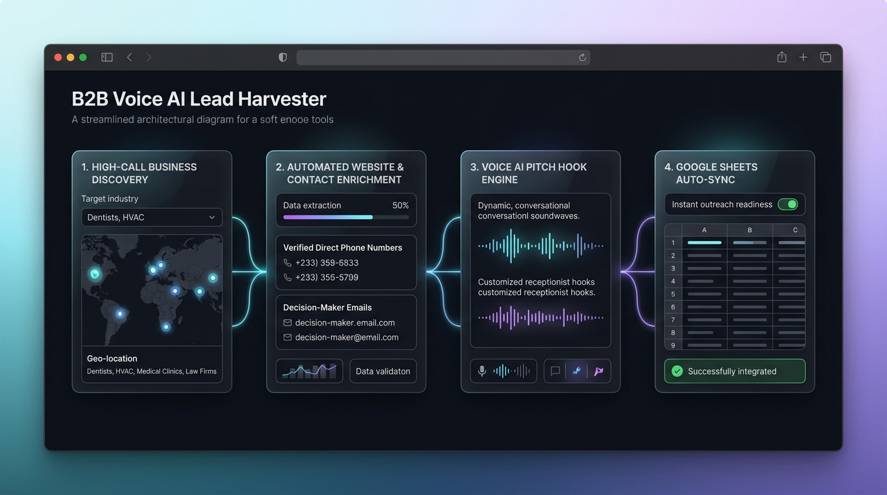

# B2B Voice AI Lead Harvester 🚀

Automated, outreach-ready lead generation pipeline designed specifically for **B2B Voice AI Agencies & Phone Automation Platforms**.

<p align="center">
  
</p>

The harvester discovers high-call-volume local businesses, crawls their websites for verified contact details and key decision-makers, crafts personalized Voice AI pitch angles, and synchronizes deduplicated lead records directly into **Google Sheets**.

---

## 🎯 Target High-Call Niches & Metro Cities


The harvester targets businesses where missed phone calls directly equal lost revenue:

### High-Intent Verticals
* **Dental Clinics (`dental`):** High new-patient acquisition value; missed calls during procedures or after 5 PM result in patients booking competitors.
* **Medical Practices (`medical`):** High inbound volume for appointment scheduling, prescription refills, and triage; reception staff regularly overwhelmed.
* **HVAC & Trades (`hvac`):** High-ticket emergency repairs; homeowners need immediate responses and call down the list until someone answers.
* **Legal Services (`legal`):** Personal injury, criminal defense, and family law where immediate intake on after-hours calls determines client retention.
* **Auto Repair & Body Shops (`autorepair`):** High phone burden for repair quotes, status updates, and towing dispatch.

### Target Metro Areas
The harvester cascades through 15 high-density, growing US markets:
* **Austin, TX**
* **Dallas, TX**
* **Miami, FL**
* **Phoenix, AZ**
* **Atlanta, GA**
* **Houston, TX**
* **Orlando, FL**
* **Tampa, FL**
* **Charlotte, NC**
* **Nashville, TN**
* **Las Vegas, NV**
* **Denver, CO**
* **San Antonio, TX**
* **Columbus, OH**
* **Indianapolis, IN**

*Additional supported metros include Chicago, Seattle, and any custom US metro configured via CLI.*

---

## 🛡️ Ironclad Multi-Key Deduplication Engine

To ensure that your Google Sheet **never receives duplicate leads at any cost**, every candidate is vetted through a 4-point deduplication engine against both existing sheet records and in-batch candidates:

1. **Normalized 10-Digit Phone Key:** Unifies international, dashed, dotted, and parenthesized numbers (e.g. `+1 (512) 555-0199` and `512.555.0199` both reduce to `5125550199`).
2. **Canonical Bare Root Domain:** Strips protocols, subdomains, paths, and tracking queries (`https://www.austindental.com/contact?src=ad` becomes `austindental.com`).
3. **Company + City Signature:** Normalizes company trade name and municipality (`"Apex Dental Studio, LLC"` in `"Austin, TX"` becomes `"apexdentalstudio::austin"`).
4. **Canonical Source URL:** Protects against repeated directory or social query URLs.

---

## 📊 Outreach-Ready Google Sheet Schema (13 Columns)

Every harvested lead is structured into an actionable 13-column format ready for cold email, cold calling, or automated CRM synchronization:

| # | Column Header | Description | Real Example |
|---|---|---|---|
| 1 | **Platform** | Source channel identifier | `B2B Directory / Web` or `Agent-Reach / Web` |
| 2 | **Name / Username** | Doctor, owner, or partner name (or role fallback) | `Dr. Darshan Patel` *(or `Practice / Business Manager`)* |
| 3 | **Business / Company** | Verified company or practice trade name | `Apex Dental Studio` |
| 4 | **Email** | Enriched business or owner email | `contact@apexdentalstudio.com` *(or `N/A`)* |
| 5 | **Phone Number** | Direct business phone number in standard format | `+1 (512) 441-2098` |
| 6 | **Website URL** | Canonical homepage URL | `https://apexdentalstudio.com` |
| 7 | **Post / Source URL** | Source directory or website link | `https://apexdentalstudio.com` |
| 8 | **Title / Subject** | Niche and location descriptor | `Dental Clinic - Austin, TX` |
| 9 | **Lead Type / Intent** | Voice AI operational deployment role | `Dental Practice - Inbound Patient Intake & After-Hours Receptionist` |
| 10 | **Pain Point / Snippet** | Concrete operational call bottleneck | *"Dental practices experience high call abandonment during lunch hours and miss after-hours emergency booking inquiries, losing new patients to competitor clinics."* |
| 11 | **Recommended Outreach Hook** | Pre-generated cold outreach pitch hook | *"Pitch an after-hours AI receptionist to Dr. Darshan Patel at Apex Dental Studio in Austin that answers patient calls 24/7, handles emergency triage, and books appointments directly into their practice calendar."* |
| 12 | **Date Captured** | UTC timestamp of discovery | `2026-10-14 09:00:00 UTC` |
| 13 | **Outreach Status** | Lead pipeline status | `Ready for Outreach` |

---

## 💻 Local Execution & CLI Options

The pipeline can be executed locally for testing, prospecting, or scheduled execution.

### 1. Prerequisites & Dependencies
```bash
# Clone repository
git clone https://github.com/Lordporus/getqualify-lead-harvester.git
cd getqualify-lead-harvester

# Install dependencies
pip install -r requirements.txt
pip install git+https://github.com/Panniantong/agent-reach.git || true
```

### 2. Dry-Run Mode (No Google Cloud Credentials Required)
Test discovery, enrichment, and pitch hook generation without writing to Google Sheets:
```bash
python scripts/scrape_leads.py --dry-run
```

### 3. Setting Lead Limits
Control the harvest size with `--limit` (default is **50 leads**):
```bash
python scripts/scrape_leads.py --dry-run --limit 50
```

### 4. Customizing Niches & Metro Cities
Target specific industries or regional campaigns via `--niches` and `--cities`:
```bash
# Target dental and HVAC businesses only
python scripts/scrape_leads.py --dry-run --niches dental hvac

# Target legal firms in Austin and Dallas
python scripts/scrape_leads.py --dry-run --niches legal --cities Austin Dallas

# Full custom campaign with limit
python scripts/scrape_leads.py --dry-run --limit 50 --niches dental medical hvac --cities Austin Dallas Miami
```

---

## ⚙️ Google Cloud Service Account & Sheets Setup

To synchronize harvested leads to a Google Sheet, configure a Google Cloud Service Account with Sheets and Drive API access:

### Step 1: Create a Service Account in Google Cloud
1. Navigate to the [Google Cloud Console](https://console.cloud.google.com/).
2. Create a new project (e.g., `lead-harvester-prod`) or select an existing project.
3. In the sidebar, navigate to **APIs & Services > Library**.
4. Search for and **Enable** both:
   - **Google Sheets API**
   - **Google Drive API**
5. Navigate to **APIs & Services > Credentials**.
6. Click **Create Credentials > Service Account**.
7. Name the service account (e.g., `lead-harvester-bot`) and click **Done**.
8. Click on your newly created service account in the credentials list.
9. Open the **Keys** tab, click **Add Key > Create new key**, select **JSON**, and click **Create**.
10. A `.json` file containing your private key credentials will download to your machine.

### Step 2: Share Your Google Sheet with the Service Account
1. Open your target Google Sheet in your web browser.
2. In your downloaded JSON key file, locate the `"client_email"` property (e.g., `lead-harvester-bot@lead-harvester-prod.iam.gserviceaccount.com`).
3. In Google Sheets, click the **Share** button in the top-right corner.
4. Paste the service account email and grant it **Editor** permissions.

### Step 3: Extract the Spreadsheet ID
Locate the ID string within your Google Sheet URL:
```text
https://docs.google.com/spreadsheets/d/1BxiMVs0XRA5nFMdKvBdBZjgmUUqptlbs74OgvE2upms/edit
                                       ^^^^^^^^^^^^^^^^^^^^^^^^^^^^^^^^^^^^^^^^^^^^
                                       This is your SPREADSHEET_ID
```

### Step 4: Configure GitHub Secrets (for GitHub Actions)
If running automated daily scrapes via GitHub Actions:
1. In your GitHub repository, open **Settings > Secrets and variables > Actions**.
2. Click **New repository secret**:
   - **Name:** `SPREADSHEET_ID`
   - **Secret:** Paste your spreadsheet ID string.
3. Click **New repository secret** again:
   - **Name:** `GCP_SA_KEY`
   - **Secret:** Open your downloaded Service Account `.json` file in a text editor, copy the entire JSON string (`{"type": "service_account", ...}`), and paste it directly.

### Step 5: Live Local Run (with Google Sheets Synchronization)
To sync to Google Sheets from your local terminal:
```bash
# macOS / Linux
export SPREADSHEET_ID="your_spreadsheet_id_here"
export GCP_SA_KEY="$(cat path/to/service_account.json)"
python scripts/scrape_leads.py --limit 50

# Windows PowerShell
$env:SPREADSHEET_ID = "your_spreadsheet_id_here"
$env:GCP_SA_KEY = Get-Content -Raw "path\to\service_account.json"
python scripts/scrape_leads.py --limit 50
```

---

## 🔄 GitHub Actions Automation

The repository includes an automated workflow defined in [`.github/workflows/scrape_leads.yml`](.github/workflows/scrape_leads.yml):

* **Daily Cron Schedule:** Runs automatically every morning at **09:00 AM IST** (`30 3 * * *` UTC).
* **Guaranteed 50 Leads:** Harvests and appends exactly 50 outreach-ready leads per run across 15 high-intent metro areas.
* **Manual Dispatch:** Supports on-demand trigger with an optional `limit` parameter directly from the GitHub Actions UI (**Actions > Run Daily Voice AI Lead Harvester > Run workflow**).
* **Multi-Key Deduplication:** Ingests all historical leads from your sheet before scraping, ensuring zero duplicate phone numbers, websites, or business signatures at any cost.
* **Rate-Limit Safe Batch Upload:** Appends all 50 leads in a single `sheet.append_rows()` API transaction to avoid hitting Google Cloud quotas.
* **Pre-flight Credential Validation:** Verifies that both `GCP_SA_KEY` and `SPREADSHEET_ID` are present before attempting network scraping.

---

## 🧪 Testing & Verification

The codebase includes comprehensive unit and integration tests across discovery, deduplication, Agent-Reach adapter, crawler enrichment, pitch hook generation, and pipeline deduplication:

```bash
# Run all tests
python -m unittest discover tests

# Run specific test modules
python -m unittest tests/test_deduplication.py
python -m unittest tests/test_b2b_discovery.py
python -m unittest tests/test_agent_reach_adapter.py
python -m unittest tests/test_enrichment.py
python -m unittest tests/test_hooks.py
python -m unittest tests/test_integration.py
```
